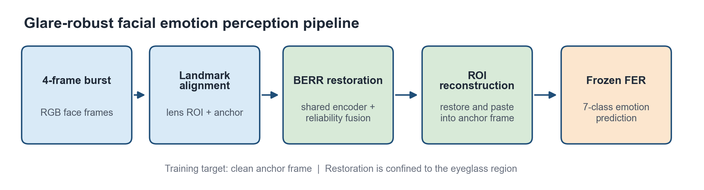
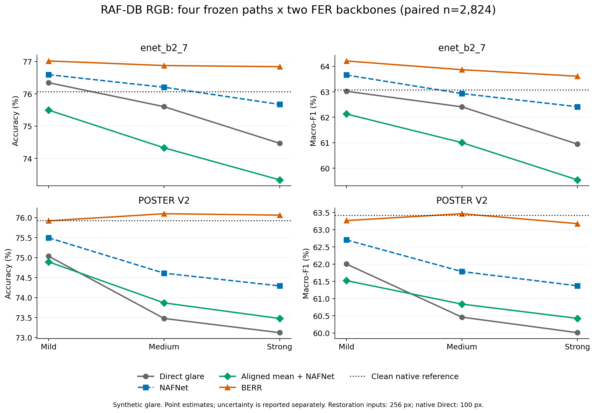
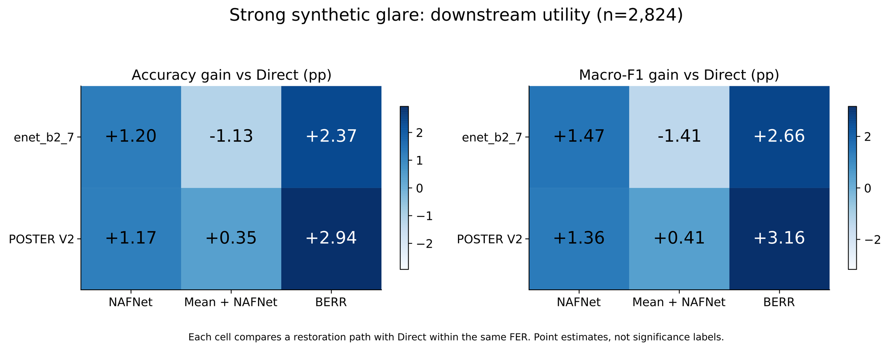

# Beyond Glare

**Reliability-Aware Burst Restoration for Robust Facial Expression Recognition**

Model: **BERR** · Synthetic dataset: **LensGlare-4**

[中文](README.zh-CN.md)

> **A lightweight eyeglass-glare removal network for robust facial expression recognition.**
> Recover expression evidence, not just image appearance.

**BERR is a compact four-frame convolutional restoration network with 1,003,847
parameters (~1.00M).** It shares one NAF-style encoder across frames, fuses evidence
according to spatial reliability, and restores a **128 × 128 eyeglass ROI** before
composing it back into the anchor image. This concentrates learned restoration on
the glare-affected region while preserving the surrounding face. The parameter
count is for BERR itself; the frozen FER recognizer and landmark detector are
separate components.
<!-- claim:C008 evidence:E004,E005 -->

## Abstract

Eyeglass glare obscures facial cues used by camera-based expression recognition,
motivating a compact restoration front end for emotion-aware learning systems.
We present **Beyond Glare**, a facial perception project designed for the group's
**emotion-aware STEM learning platform**, centered on **Burst Eyeglass Reflection
Removal (BERR)**: a lightweight four-frame convolutional network with **1,003,847
parameters (~1.00M)**. BERR aligns eyeglass regions, extracts shared multi-scale
features, and fuses complementary observations according to their spatial
reliability. Visible/prior decoding and local composition restore the affected
region while preserving the anchor context. We construct **LensGlare-4**, comprising
**2,243 synthetic four-frame bursts** with clean-source-disjoint splits for
restoration training and evaluation. For application integration, the project
combines frozen facial expression recognition (FER), confidence-based rejection,
and rule-based five-state contract adaptation to supply visual cues for backend
text/face fusion, teaching feedback, and learning reports. Integration distinguishes
the existing single-image direct-FER service from the BERR-enabled route, which
requires a four-frame request extension. In a paired RAF-DB RGB evaluation on
**2,824 faces** under synthetic Strong glare, BERR improves Accuracy / Macro-F1
over direct FER by **+2.37 / +2.66 percentage points** with enet_b2_7 and
**+2.94 / +3.16 points** with POSTER V2, with all evaluated model weights fixed.
<!-- claim:C001 evidence:E001,E002,E004,E005,E006,E007 -->

## Pipeline



*BERR-enabled inference pipeline.* Four observations are aligned to an anchor,
restored through shared encoding and reliability fusion, and locally composed
before frozen FER. ROI reconstruction/composition is part of BERR, displayed as a
separate logical stage. This figure shows the four-frame research path; the group's
existing single-JPEG interface and the burst integration route are distinguished
[below](#integration-into-the-group-learning-platform).
<!-- claim:C010 evidence:E005,E008 -->

## Contributions

- **Reliability-aware burst restoration.** BERR converts four aligned observations
  into one restored face through shared NAF-style encoding, dense degradation
  estimation, and spatially adaptive multi-scale feature fusion.
- **Localized visible/prior reconstruction.** A ~1M-parameter network combines
  complementary frame evidence and learned reconstruction, then softly composes the
  restored eyeglass ROI into the anchor. LensGlare-4 supplies **2,243 synthetic bursts**
  from **610 clean sources**, with source-disjoint training, validation, and test splits.
- **Cross-recognizer downstream evidence.** A fixed RGB test cohort, four restoration
  paths, two frozen FER backbones, and paired statistical comparisons show that BERR's
  Strong-glare advantage extends across the two evaluated recognizers and beyond
  equal-weight RGB averaging.
<!-- claim:C002 evidence:E001,E002,E003,E004,E005,E006 -->

## Methodology

BERR takes four RGB frames and returns one restored image in frame 0's coordinates.
The five stages operate on a landmark-aligned **128 × 128 eyeglass ROI**:

| Stage | Structure | Role |
|---|---|---|
| 1. Geometric alignment | Landmark similarity transform + differentiable sampling | Put all observations into the anchor ROI coordinates. |
| 2. Shared encoding | Three-scale NAF-style CNN; width 32; encoder blocks (2, 2, 4) | Encode RGB + geometry heatmap with shared weights across frames. |
| 3. Reliability fusion | Depthwise-separable degradation head + frame-wise softmax | Downweight degraded evidence at each position and feature scale. |
| 4. Visible/prior decoding | NAF-style multi-scale decoder + two RGB residual heads | Combine anchor and fused features into visible-evidence and prior reconstructions. |
| 5. Local composition | Degradation-conditioned blending + feathered ROI paste | Restore the affected region while retaining the anchor context. |

At scale *s*, feature fusion is `F_s = Σ_t softmax_t(−d_t,s / τ) · F_t,s`,
where *d* is a degradation logit and **τ = 0.15**. A spatial gate derived from
degradation across all frames mixes the visible and prior reconstructions.
Training uses image-reconstruction and degradation-mask supervision; the downstream
FER is frozen and is not part of the restoration training objective.
<!-- claim:C003 evidence:E005 -->

## Integration into the group learning platform

The facial module provides one visual signal for the group's emotion-aware STEM
learning platform. The application backend combines this signal with text emotion;
teaching-strategy and report-generation modules consume the resulting records.

- **Capture and call.** On a learning interaction, the frontend sends a camera JPEG
  to the group backend, which calls the deployment-specific `POST /recognize` service.
- **Recognize and adapt.** The service detects/crops a face, runs frozen FER, applies
  confidence rejection, and maps accepted seven-class predictions to the group's
  five-state contract, returning `emotion` and `confidence`. The five-state mapping
  is an engineering adapter, not a separately trained learning-state classifier;
  confidence refers to the FER prediction.
- **Fuse and consume.** The backend handles text/face fusion, database writes,
  teaching strategies, and reports. On no-face, rejected, or failed facial results,
  the integration contract calls for `facial_value = null` and text-only fallback.

**Where BERR fits.** The current single-JPEG contract uses **direct FER, without
BERR**. To enable the pipeline above, extend capture/upload to carry **four distinct,
consecutive frames from the same student interaction** in one request; a burst-capable
adapter then runs preprocessing → BERR → FER → confidence assessment → contract
mapping. Do not duplicate one image or accumulate frames across learning events.
The public [four-frame demo](demo_vision.py) and [video demo](demo_video.py) provide
the research inference path. The group-specific HTTP adapter, mapping, and backend
infrastructure are maintained outside this research-code release; this section
documents the integration boundary rather than introducing a new HTTP endpoint.
<!-- claim:C009 evidence:E005,E007 -->

## Experiments

**Protocol.** The RGB downstream benchmark applies deterministic Mild / Medium / Strong
synthetic lens glare to RAF-DB. All four paths and both AffectNet-7-pretrained FER
backbones use the same **2,824 paired faces**: **92.05% of the 3,068-image official test
split**, with 244 detection failures retained in the coverage denominator. Direct
recognition uses the native 100 × 100 image; restoration inputs are matched at
256 × 256. The synthetic geometry is clean-derived. All top-1 predictions in the
paired cohort are scored, with rejection disabled. We keep BERR, NAFNet, and FER
weights fixed and do not tune thresholds on RAF-DB test.
<!-- claim:C004 evidence:E001,E002 -->

### 1. Downstream robustness across recognizers and glare strengths



*Figure 1 (project Fig. 6d).* Top: enet_b2_7; bottom: POSTER V2. BERR leads the four
paths in both metrics at all three evaluated strengths. Its advantage over Direct
widens as glare increases. Curves are point estimates on the same 2,824 faces;
dotted lines are clean native references, not accuracy ceilings.

**Strong-glare results.** Accuracy and Macro-F1 are percentages; bold identifies the
best point estimate among the four paths within each recognizer.

| Restoration path | enet Accuracy ↑ | enet Macro-F1 ↑ | POSTER V2 Accuracy ↑ | POSTER V2 Macro-F1 ↑ |
|---|---:|---:|---:|---:|
| Direct glare | 74.47 | 60.95 | 73.12 | 60.01 |
| Single-frame NAFNet | 75.67 | 62.41 | 74.29 | 61.37 |
| Aligned 4-frame mean + NAFNet | 73.34 | 59.54 | 73.48 | 60.42 |
| **BERR** | **76.84** | **63.61** | **76.06** | **63.17** |

Against matched-resolution NAFNet, BERR gains **+1.17 / +1.20 points** in
Accuracy / Macro-F1 with enet and **+1.77 / +1.81 points** with POSTER V2.
The corresponding paired 95% intervals are **[+0.39, +1.95] / [+0.11, +2.28]**
and **[+0.96, +2.62] / [+0.82, +2.82]** points. Intervals use 5,000 source-paired
bootstrap resamples and are unadjusted per comparison. Accuracy additionally
passes exact McNemar tests with Holm correction over the six backbone × severity
tests in this comparison family (adjusted *p* = **0.0213 / 0.000173**, respectively).
<!-- claim:C005 evidence:E002 -->

### 2. Four-frame restoration beyond RGB averaging



*Figure 2 (project Fig. 6e).* Signed gains over Direct under Strong synthetic glare,
in percentage points, on the same 2,824 faces. The approved blue palette is reused
unchanged; panels have separate color scales, so the printed values define cross-metric
comparisons. BERR exceeds aligned mean + NAFNet by **+3.51 / +4.07 points** with enet
and **+2.58 / +2.75 points** with POSTER V2 (Accuracy / Macro-F1).

The mean baseline uses the same four frames and landmark-based alignment, followed
by full-face equal-weight RGB averaging and the same frozen NAFNet. This comparison
supports BERR's complete burst-restoration design over averaging before restoration;
it is a system-level comparison, not an isolated causal ablation of reliability fusion.
<!-- claim:C006 evidence:E001,E002,E005 -->

### 3. Complementary observations improve the same frozen network

On the source-disjoint LensGlare-4 test split (**152 CelebAMaskHQ-derived and 74
FFHQ-derived bursts**), keep the BERR checkpoint fixed and vary the distinct input
observations. One- and two-observation inputs are repeated to fill the four slots.

| Distinct observations | Celeb ROI-PSNR ↑ (dB) | FFHQ ROI-PSNR ↑ (dB) |
|---|---:|---:|
| 1, repeated | 27.975 | 26.087 |
| 2, repeated | 28.333 | 26.604 |
| **4** | **28.505** | **26.858** |

ROI-PSNR increases monotonically, with unrounded 4F − 1F gains of **+0.530 dB**
and **+0.770 dB**. This fixed-checkpoint evidence test separates the benefit of
additional observations from changing network capacity or training another model.
<!-- claim:C007 evidence:E003,E004,E006 -->

**Takeaway.** BERR turns complementary four-frame evidence into stronger expression
recognition under synthetic eyeglass glare, with gains reproduced across two frozen
recognizers. [Evidence, full-strength results, and figure provenance](docs/RESEARCH_EVIDENCE.md)
define the reported protocol and distinguish these recorded experiments from local
runs of the portable release code.

---

## Code and reproducibility

Code-only release candidate for **Burst Eyeglass Reflection Removal (BERR)**
and glare-robust facial expression recognition. **LensGlare-4** is the project's
four-frame synthetic eyeglass-glare dataset name; its images are not distributed here.

The original research workspace is not modified by this export. This repository
contains no datasets, trained weights, prediction caches, private server settings,
student images, API credentials, or old Git history.

## What is included

- BERR: landmark alignment, shared NAF-style encoder, degradation estimation,
  reliability-aware multi-scale fusion, visible/prior decoding, and ROI composition.
- Training, restoration evaluation, source-level splitting, and 1F/2F/4F evidence tests.
- Single-frame NAFNet and parameter-free aligned-four-frame-mean baselines.
- Frozen enet_b2_7 integration and an optional external POSTER V2 adapter.
- Four-path, dual-FER evaluation from a user-supplied labelled manifest, including
  coverage, paired bootstrap CIs, exact McNemar tests, and per-family Holm correction.
- Four-frame/video demos, confidence rejection, and optional experimental glare gating.
- Offline unit tests and a synthetic training smoke configuration.

## Install

Python **3.10** is the tested interpreter. Use a dedicated virtual environment: the
top-level `models` and `datasets` packages may conflict with unrelated projects.

```bash
python3.10 -m venv .venv
source .venv/bin/activate
python -m pip install --upgrade pip
# CPU example; for CUDA use the appropriate official PyTorch wheel selection.
pip install torch==2.10.0 torchvision==0.25.0 --index-url https://download.pytorch.org/whl/cpu
pip install -r requirements-dev.txt
pip install --no-deps emotiefflib==1.1.1
```

For a smaller installation, choose `requirements.txt`, `requirements-train.txt`,
or `requirements-fer.txt` as needed. EmotiEffLib is installed
separately with `--no-deps` to reuse MediaPipe's OpenCV distribution. On Linux,
OpenCV/MediaPipe may also need `libgl1`, `libglib2.0-0`, and `libportaudio2`.
`pip check` may consequently report EmotiEffLib's `opencv-python` metadata
requirement as missing even though `cv2` is supplied by `opencv-contrib-python`.
This expected metadata mismatch was observed in validation; do not install a
second OpenCV distribution simply to silence it. Verify that `import cv2` works.

## Run without data or downloaded weights

```bash
OMP_NUM_THREADS=1 MKL_NUM_THREADS=1 pytest -q
OMP_NUM_THREADS=1 python -m scripts.train_berr \
  --config configs/berr/smoke.yaml --dry-run --device cpu --max-steps 1
python scripts/check_release.py
```

These tests use temporary generated tensors/checkpoints and mock FER backends.
The smoke model is tiny and randomly initialized: it is not the trained research
model and its outputs must not be presented as restoration results.

## Supply assets locally

The following files are deliberately excluded and ignored by Git:

```text
assets/face_landmarker.task             # separately obtained MediaPipe model
checkpoints/berr.pt                     # your trained BERR checkpoint
checkpoints/nafnet.pt                   # your trained project NAFNet checkpoint
```

The enet_b2_7 ONNX model is managed by EmotiEffLib in `~/.emotiefflib/` and may
be downloaded on the first real FER initialization. Obtain it from its upstream
project in advance for offline use. Model and data redistribution rights are
separate from this repository's code license. See [THIRD_PARTY_NOTICES.md](THIRD_PARTY_NOTICES.md).
No public BERR checkpoint download is claimed by this code-only package.

To rebuild the confidence policy using your authorized local RAF-DB train split,
run `python -m scripts.calibrate_fer_confidence --help`. Threshold selection uses
train only; test is for reporting, not threshold selection. Prefer a new
`--artifact` output rather than overwriting the bundled historical policy.

## Train and evaluate BERR

Put your independently authorized prepared data under the roots in
`configs/berr/combined.yaml`, or edit those roots before training. See
[docs/DATA_FORMAT.md](docs/DATA_FORMAT.md). Use source-disjoint train/val/test splits.

```bash
python -m scripts.train_berr --config configs/berr/combined.yaml --device cuda
python -m scripts.eval_berr --config configs/berr/combined.yaml \
  --checkpoint checkpoints/berr.pt --split test --device cuda
python -m scripts.evaluate_frame_ablation --config configs/berr/combined.yaml \
  --checkpoint checkpoints/berr.pt --celeb-root data/lensglare4/celeb/test \
  --ffhq-root data/lensglare4/ffhq/test --device cuda
```

Training checkpoints are saved below `outputs/berr/`; copy or point the inference
configuration at the checkpoint selected using validation, not test performance.
`scripts/run_single_frame_baseline.py` trains/evaluates the project NAFNet baseline.
`scripts/create_source_level_resplit.py --help` creates source-level split views.

## Four-frame inference

```bash
python demo_vision.py --frames f0.jpg f1.jpg f2.jpg f3.jpg \
  --config configs/vision.yaml --checkpoint checkpoints/berr.pt --device cpu
python demo_video.py --help
```

Use a short burst from one subject/event. Do not duplicate a single camera image
or combine different student events to simulate a genuine burst. `auto` is an
experimental mode requiring a separately trained gate; no gate pickle is bundled.
The release default retains `always_restore` with gating disabled, rather than
silently inventing a replacement for the excluded gate artifact.

## Four-path FER evaluation

This portable entry point replaces private historical chained runs. It prepares
one shared lossless PNG cache and evaluates each FER on the same pixels. It does
not require old result folders, and does not claim bit-for-bit replay of the
private historical cohort without its exact data, manifests, and checkpoints.

```bash
# Independently obtain RAF-DB under its terms; no download is performed here.
python -m scripts.prepare_rafdb_manifest --raf-root data/RAF-DB --output-root data/rafdb
python -m scripts.evaluate_fer_paths prepare --manifest data/rafdb/metadata.csv \
  --output-dir outputs/fer_paths --device cuda
python -m scripts.evaluate_fer_paths infer --backend enet --output-dir outputs/fer_paths
# Optional, in a compatible environment with upstream POSTER dependencies:
python -m scripts.evaluate_fer_paths infer --backend poster --output-dir outputs/fer_paths \
  --poster-root third_party/POSTER_V2 --poster-checkpoint checkpoints/poster_v2_affectnet7.pth \
  --device cuda
python -m scripts.evaluate_fer_paths analyze --output-dir outputs/fer_paths \
  --backends enet poster --bootstrap-trials 5000
```

For enet only, analyze with `--backends enet`. Always use a fresh empty output
directory for `prepare`; inference refuses to overwrite existing predictions.
POSTER upstream code and its `ir50.pth` / `mobilefacenet_model_best.pth.tar` inputs
must be obtained separately and placed under its expected `models/pretrain/` folder.
Use only trusted checkpoints; PyTorch pickle loading can execute code.

Important evaluation boundaries:

- `NAFNet`: one glare anchor resized to the matched restoration resolution.
- `Mean + NAFNet`: four aligned RGB images averaged equally, then the same NAFNet.
- `BERR`: four frames, learned feature fusion, and local restoration/composition.
- All top-1 predictions participate; confidence rejection is not used to inflate accuracy.
- Detection/inference failures remain in coverage reporting; paired metrics use common
  complete sources across all selected backends and conditions.
- The synthetic geometry is derived from clean images. This is not a real-video or
  corrupted-image landmark-detection benchmark. The baseline is not a single-module
  causal ablation of reliability fusion.

## License and publication

Project-owned code is provided under [MIT](LICENSE). Framework dependencies,
upstream architectures, separately obtained model weights, datasets and any future
borrowed code retain their own terms. See [THIRD_PARTY_NOTICES.md](THIRD_PARTY_NOTICES.md).

This export has no inherited Git history. Before your first GitHub commit, inspect
the file list and run `python scripts/check_release.py`. Do not force-add ignored
weights, datasets, `.env` files or test outputs. Public GitHub creation/push is a
separate action and is not performed by this package.
