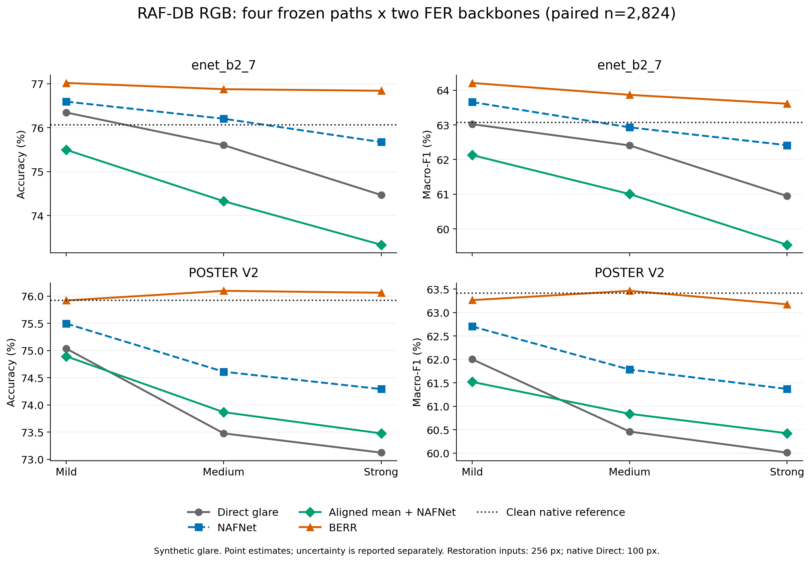
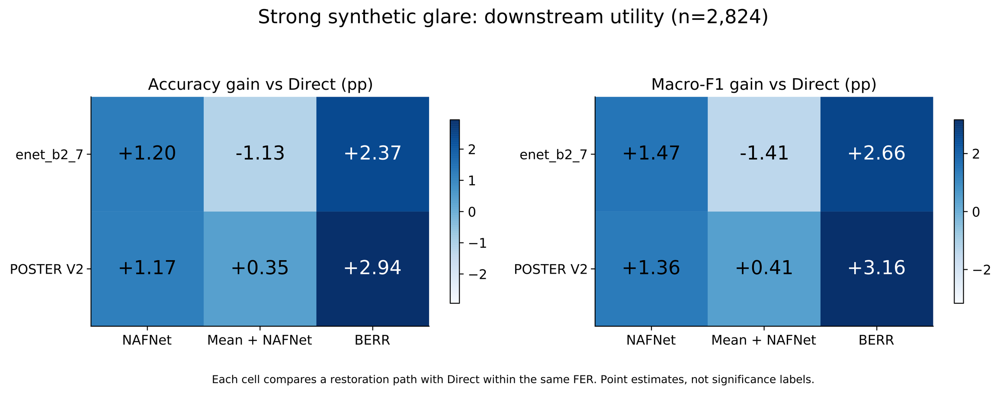

# Beyond Glare

**面向鲁棒面部表情识别的可靠性感知多帧恢复**

模型：**BERR** · 合成数据集：**LensGlare-4**

[English](README.md)

> **恢复表情识别所需的证据，而不止改善图像外观。** 用约 1M 参数的四帧恢复网络，在两个冻结 FER 模型上验证眼镜反光去除的下游收益。

## 摘要（Abstract）

眼镜反光遮挡眼部细节，干扰面部表情识别（FER）。单帧观察无法直接利用其他帧中可见的人脸信息，而四帧等权平均又不能区分清晰证据与反光污染。我们提出 **BERR（Burst Eyeglass Reflection Removal）**，一个四帧输入、单帧输出的眼镜反光恢复网络：通过眼镜区域对齐、空间退化估计与可靠性感知的多尺度特征融合，聚合互补观察；再由 visible/prior 双头解码与局部合成恢复受影响区域，保留锚帧的区域外上下文。在 **2,824 张配对人脸**的 RAF-DB RGB 合成反光评估中，Strong 条件下，BERR 相对直接识别的 Accuracy / Macro-F1 增益在 enet_b2_7 上为 **+2.37 / +2.66 个百分点**，在 POSTER V2 上为 **+2.94 / +3.16 个百分点**。在两个识别器、两个指标上，BERR 同时优于匹配恢复尺度的单帧 NAFNet 与“四帧对齐平均＋NAFNet”，且本次评估不重训恢复网络或 FER。结果验证了 BERR 四帧恢复设计在该合成反光协议下的下游价值。
<!-- claim:C001 evidence:E001,E002 -->

## 核心贡献（Contributions）

- **可靠性感知的四帧恢复。** 以共享 NAF 风格编码、稠密退化估计和空间自适应多尺度融合，将四帧对齐观察转化为一张恢复人脸。
- **局部 visible/prior 重建。** 约 1M 参数的网络结合跨帧可见证据与学习先验，通过软合成将恢复结果贴回眼镜 ROI。配套的 LensGlare-4 包含来自 **610 个 clean source 的 2,243 个合成 burst**，采用 source-disjoint 的训练、验证和测试划分。
- **跨识别器的下游验证。** 固定 RGB 测试队列、四条恢复路径、两个冻结 FER 与配对统计，验证 Strong 条件下的优势覆盖两个已测识别器，并超越四帧等权 RGB 平均。
<!-- claim:C002 evidence:E001,E002,E003,E004,E005,E006 -->

## 方法概述（Methodology）

BERR 接收四帧 RGB，输出第 0 帧坐标系下的一张恢复图像。网络围绕关键点对齐的 **128 × 128 眼镜 ROI**，分为五步：

| 步骤 | 内部结构 | 作用 |
|---|---|---|
| 1. 几何对齐 | 关键点相似变换＋可微采样 | 将四帧映射到锚帧 ROI 坐标系。 |
| 2. 共享编码 | 三尺度 NAF 风格 CNN；宽度 32；编码块数 (2, 2, 4) | 各帧共用权重，编码 RGB 与几何热图。 |
| 3. 可靠性融合 | 深度可分离卷积退化头＋帧间 softmax | 在各位置、各特征尺度上降低退化证据的权重。 |
| 4. 双头解码 | NAF 风格多尺度解码器＋两个 RGB 残差头 | 结合锚帧与融合特征，输出 visible 和 prior 重建。 |
| 5. 局部合成 | 退化条件混合＋羽化 ROI 贴回 | 恢复受影响区域，同时保留锚帧上下文。 |

尺度 *s* 上的融合为 `F_s = Σ_t softmax_t(−d_t,s / τ) · F_t,s`，其中 *d* 为退化 logit，**τ = 0.15**。由各帧退化估计共同得到的空间门控混合 visible 与 prior 重建。训练采用图像重建与退化掩码监督；下游 FER 保持冻结，不参与恢复网络的训练目标。
<!-- claim:C003 evidence:E005 -->

## 实验概述（Experiments）

**统一协议。** 在 RAF-DB RGB 人脸上确定性合成 Mild / Medium / Strong 镜片反光。四条路径与两个 AffectNet-7 预训练 FER 共用 **2,824 张配对人脸**，占官方 **3,068 张 test 的 92.05%**；244 张检测失败保留在覆盖率分母中。Direct 使用原生 100 × 100 输入，各恢复路径的输入尺度匹配为 256 × 256；合成几何来自 clean 图像。配对队列中的全部 top-1 预测参与统计，不启用拒识。本次对照固定 BERR、NAFNet 与 FER 权重，不在 RAF-DB test 上调阈值。
<!-- claim:C004 evidence:E001,E002 -->

### 1. 跨识别器、跨反光强度的下游鲁棒性



*图 1（项目图 6d）。* 上排为 enet_b2_7，下排为 POSTER V2。BERR 在三个已测强度、两个指标上均位于四条路径的最上方；随着反光增强，其相对 Direct 的优势扩大。曲线为同一批 2,824 张人脸上的点估计；点线是 clean 原生图像参考，不代表准确率上限。

**Strong 主结果。** Accuracy 与 Macro-F1 的单位为百分比；粗体表示同一识别器下四条路径中的最佳点估计。

| 恢复路径 | enet Accuracy ↑ | enet Macro-F1 ↑ | POSTER V2 Accuracy ↑ | POSTER V2 Macro-F1 ↑ |
|---|---:|---:|---:|---:|
| 直接识别反光图 | 74.47 | 60.95 | 73.12 | 60.01 |
| 单帧 NAFNet | 75.67 | 62.41 | 74.29 | 61.37 |
| 四帧对齐平均＋NAFNet | 73.34 | 59.54 | 73.48 | 60.42 |
| **BERR** | **76.84** | **63.61** | **76.06** | **63.17** |

相对匹配恢复尺度的 NAFNet，BERR 的 Accuracy / Macro-F1 在 enet 上提升 **+1.17 / +1.20 个百分点**，在 POSTER V2 上提升 **+1.77 / +1.81 个百分点**。对应的配对 95% 区间分别为 **[+0.39, +1.95] / [+0.11, +2.28]** 和 **[+0.96, +2.62] / [+0.82, +2.82]** 个百分点。区间采用 5,000 次 source-paired bootstrap，为逐项、未多重校正区间。Accuracy 还通过了 exact McNemar 检验，并在该对比族的六次“骨干 × 强度”检验中进行 Holm 校正，校正后 *p* 分别为 **0.0213 / 0.000173**。
<!-- claim:C005 evidence:E002 -->

### 2. 四帧恢复的价值超越 RGB 平均



*图 2（项目图 6e）。* 同一批 2,824 张人脸在 Strong 合成反光下相对 Direct 的百分点差值。沿用已确认的蓝色版本，不改动图像；两面板的色标范围独立，跨指标比较以标注数字为准。BERR 相对“四帧对齐平均＋NAFNet”的 Accuracy / Macro-F1 优势，在 enet 上为 **+3.51 / +4.07 个百分点**，在 POSTER V2 上为 **+2.58 / +2.75 个百分点**。

平均基线使用同一批四帧和关键点对齐，随后进行全脸等权 RGB 平均，再交给同一个冻结 NAFNet。该结果支持 BERR 的完整四帧恢复设计优于“先平均、再恢复”；这是系统级对照，而非可靠性融合单模块的因果消融。
<!-- claim:C006 evidence:E001,E002,E005 -->

### 3. 同一冻结网络从互补观察中获得增益

在 source-disjoint 的 LensGlare-4 测试集上（**152 个 CelebAMaskHQ 来源 burst、74 个 FFHQ 来源 burst**），固定同一个 BERR checkpoint，改变不同观察的数量；1 帧和 2 帧输入通过重复填满四个槽位。

| 不同观察数 | Celeb ROI-PSNR ↑（dB） | FFHQ ROI-PSNR ↑（dB） |
|---|---:|---:|
| 1 帧，重复填充 | 27.975 | 26.087 |
| 2 帧，重复填充 | 28.333 | 26.604 |
| **4 帧** | **28.505** | **26.858** |

ROI-PSNR 随观察数单调提升；基于未舍入数值，4F − 1F 分别为 **+0.530 dB** 与 **+0.770 dB**。固定 checkpoint 的证据数量实验，将额外观察的收益与网络扩容、重新训练模型区分开来。
<!-- claim:C007 evidence:E003,E004,E006 -->

**核心结论。** BERR 将四帧互补证据转化为合成眼镜反光下更强的表情识别能力，并在两个冻结识别器上复现下游收益。[证据、完整强度结果与图表来源](docs/RESEARCH_EVIDENCE.md) 记录评估口径，并区分这里报告的既有实验与开源入口的本地运行。

---

## 代码与复现

**突发眼镜反光去除（Burst Eyeglass Reflection Removal, BERR）** 与抗眩光面部表情识别的纯代码发布候选版本。**LensGlare-4** 是本项目四帧合成眼镜眩光数据集的名称；其图像不在本仓库中分发。

## 包含内容

- BERR：关键点对齐、共享的 NAF 风格编码器、退化估计、可靠性感知的多尺度融合、可见光/先验解码，以及 ROI 合成。
- 训练、复原评估、按来源划分数据，以及 1F/2F/4F 证据测试。
- 单帧 NAFNet 基线，以及无参数的对齐四帧均值基线。
- 冻结的 enet_b2_7 集成，以及可选的外部 POSTER V2 适配器。
- 基于用户提供的带标签清单进行四路径、双 FER 评估，包括覆盖率、配对 bootstrap 置信区间、精确 McNemar 检验，以及按族进行的 Holm 校正。
- 四帧/视频演示、置信度拒识，以及可选的实验性眩光门控。
- 离线单元测试，以及一套合成数据训练的冒烟配置。

## 安装

已测试的解释器为 Python **3.10**。请使用独立的虚拟环境：顶层的 `models` 与 `datasets` 包可能与无关项目冲突。

```bash
python3.10 -m venv .venv
source .venv/bin/activate
python -m pip install --upgrade pip
# CPU 示例；使用 CUDA 时请选择对应的官方 PyTorch wheel。
pip install torch==2.10.0 torchvision==0.25.0 --index-url https://download.pytorch.org/whl/cpu
pip install -r requirements-dev.txt
pip install --no-deps emotiefflib==1.1.1
```

若只需较小的安装集，可按需选用 `requirements.txt`、`requirements-train.txt` 或 `requirements-fer.txt`。EmotiEffLib 使用 `--no-deps` 单独安装，以便复用 MediaPipe 所带的 OpenCV 发行版。在 Linux 上，OpenCV/MediaPipe 可能还需要 `libgl1`、`libglib2.0-0` 和 `libportaudio2`。因此 `pip check` 可能报告缺少 EmotiEffLib 元数据中声明的 `opencv-python`，但 `cv2` 实际由 `opencv-contrib-python` 提供。验证时已观察到这一预期的元数据不一致；不要为了消除该提示而再安装一份 OpenCV。请确认 `import cv2` 可以正常工作。

## 在没有数据或已下载权重时运行

```bash
OMP_NUM_THREADS=1 MKL_NUM_THREADS=1 pytest -q
OMP_NUM_THREADS=1 python -m scripts.train_berr \
  --config configs/berr/smoke.yaml --dry-run --device cpu --max-steps 1
python scripts/check_release.py
```

这些测试使用临时生成的张量/检查点，以及模拟的 FER 后端。冒烟模型很小且为随机初始化：它不是已训练的研究模型，其输出不得当作复原结果展示。

## 在本地提供资源

以下文件被有意排除，且被 Git 忽略：

```text
assets/face_landmarker.task             # 另行获取的 MediaPipe 模型
checkpoints/berr.pt                     # 你训练得到的 BERR 检查点
checkpoints/nafnet.pt                   # 你训练得到的本项目 NAFNet 检查点
```

enet_b2_7 的 ONNX 模型由 EmotiEffLib 管理，位于 `~/.emotiefflib/`，并可能在首次真正初始化 FER 时下载。若需离线使用，请提前从其上游项目获取。模型与数据的再分发权利独立于本仓库的代码许可。参见 [THIRD_PARTY_NOTICES.md](THIRD_PARTY_NOTICES.md)。本纯代码包不声称提供公开的 BERR 检查点下载。

若要使用你有权使用的本地 RAF-DB 训练集重建置信度策略，请运行 `python -m scripts.calibrate_fer_confidence --help`。阈值选择只使用训练集；测试集仅用于报告，不用于选择阈值。请优先用新的 `--artifact` 输出，而不是覆盖随包附带的历史策略。

## 训练与评估 BERR

将你独立获得授权、且已准备好的数据放到 `configs/berr/combined.yaml` 中的根目录下，或在训练前修改这些根目录。参见 [docs/DATA_FORMAT.md](docs/DATA_FORMAT.md)。请使用来源互不相交的训练/验证/测试划分。

```bash
python -m scripts.train_berr --config configs/berr/combined.yaml --device cuda
python -m scripts.eval_berr --config configs/berr/combined.yaml \
  --checkpoint checkpoints/berr.pt --split test --device cuda
python -m scripts.evaluate_frame_ablation --config configs/berr/combined.yaml \
  --checkpoint checkpoints/berr.pt --celeb-root data/lensglare4/celeb/test \
  --ffhq-root data/lensglare4/ffhq/test --device cuda
```

训练检查点保存在 `outputs/berr/` 之下；请把推理配置复制或指向依据验证集（而非测试集表现）选出的检查点。`scripts/run_single_frame_baseline.py` 用于训练/评估本项目的 NAFNet 基线。`scripts/create_source_level_resplit.py --help` 用于创建按来源划分的数据视图。

## 四帧推理

```bash
python demo_vision.py --frames f0.jpg f1.jpg f2.jpg f3.jpg \
  --config configs/vision.yaml --checkpoint checkpoints/berr.pt --device cpu
python demo_video.py --help
```

请使用同一主体/同一事件的短时突发序列。不要复制同一张相机图像，也不要把不同学生事件拼在一起，以此来模拟真实突发。`auto` 是实验模式，需要单独训练的门控模型；仓库不附带门控 pickle。发布默认保留 `always_restore` 且关闭门控，而不是默默编造一个被排除的门控产物的替代品。

## 四路径 FER 评估

这个可移植入口替代了私有的历史链式运行。它准备一份共享的无损 PNG 缓存，并让每个 FER 在相同像素上评估。它不依赖旧的结果目录，也不声称能在缺少完全相同的数据、清单和检查点时，对私有历史队列做逐比特重放。

```bash
# 请按 RAF-DB 自身条款独立获取数据；此处不会执行下载。
python -m scripts.prepare_rafdb_manifest --raf-root data/RAF-DB --output-root data/rafdb
python -m scripts.evaluate_fer_paths prepare --manifest data/rafdb/metadata.csv \
  --output-dir outputs/fer_paths --device cuda
python -m scripts.evaluate_fer_paths infer --backend enet --output-dir outputs/fer_paths
# 可选：在装有上游 POSTER 依赖的兼容环境中运行：
python -m scripts.evaluate_fer_paths infer --backend poster --output-dir outputs/fer_paths \
  --poster-root third_party/POSTER_V2 --poster-checkpoint checkpoints/poster_v2_affectnet7.pth \
  --device cuda
python -m scripts.evaluate_fer_paths analyze --output-dir outputs/fer_paths \
  --backends enet poster --bootstrap-trials 5000
```

若只用 enet，分析时加上 `--backends enet`。`prepare` 始终使用一个全新的空输出目录；推理会拒绝覆盖已有预测。POSTER 上游代码及其 `ir50.pth` / `mobilefacenet_model_best.pth.tar` 输入须另行获取，并放到它期望的 `models/pretrain/` 目录下。只使用可信的检查点；PyTorch 的 pickle 加载可以执行代码。

评估边界：

- `NAFNet`：将一张眩光锚帧缩放到与复原结果匹配的分辨率。
- `Mean + NAFNet`：四张对齐的 RGB 图像等权平均，再送入同一个 NAFNet。
- `BERR`：四帧输入、学习得到的特征融合，以及局部复原/合成。
- 所有 top-1 预测都参与统计；不用置信度拒识来抬高准确率。
- 检测/推理失败仍计入覆盖率报告；配对指标使用所有已选后端与条件上共同完整的来源。
- 合成几何来自干净图像。这不是真实视频或损坏图像上的关键点检测基准。该基线也不是对可靠性融合做单模块因果消融。

## 许可与发表

项目自有代码以 [MIT](LICENSE) 提供。框架依赖、上游架构、另行获取的模型权重、数据集，以及将来任何借用的代码，均保留其自身条款。参见 [THIRD_PARTY_NOTICES.md](THIRD_PARTY_NOTICES.md)。

本次导出没有继承的 Git 历史。在第一次提交到 GitHub 之前，请检查文件列表并运行 `python scripts/check_release.py`。不要强制添加被忽略的权重、数据集、`.env` 文件或测试输出。创建或推送到公开的 GitHub 仓库是单独的操作，本包不会代为执行。
